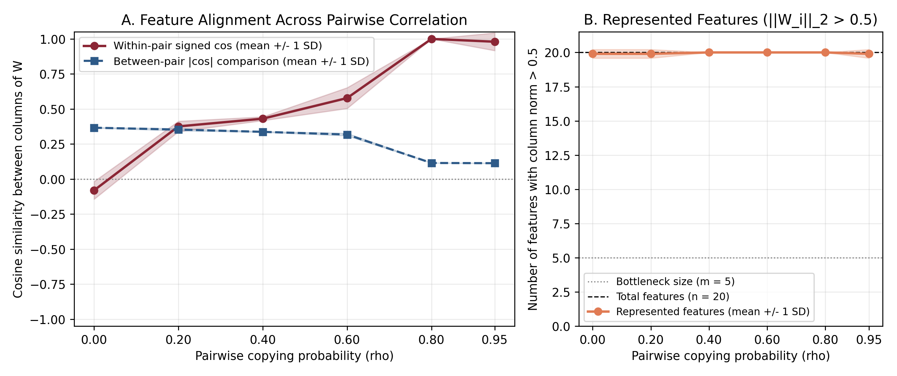

# Correlated Inputs in a Toy Bottleneck Network

Author: Oz (Özge Tepeli)

## Question

When 20 sparse features come in 10 correlated pairs, do a bottleneck network's weight directions for the two features in a pair merge into one direction, and at what correlation?

## Experimental Design

Each input vector has `n = 20` sparse features grouped into 10 pairs: `(0, 1), (2, 3), ..., (18, 19)`. To keep correlation from being confounded with feature frequency, I fixed every feature's marginal firing rate at `p = 0.05` (with active values drawn from `Uniform(0, 1)`). Within each pair, feature A fires independently at rate `0.05`, and feature B copies feature A's exact activity with probability `rho` or is drawn independently from the same `p = 0.05, Uniform(0, 1)` distribution with probability `1 - rho`. The unit tests in `data.py` check on `200,000` samples that the empirical firing rate stays at `0.05` and the realised within-pair correlation matches `rho` across conditions.

The model (`model.py`) is a tied-weight bottleneck network `x_hat = ReLU(W^T W x + b)` with `W` of shape `(5, 20)` and bias `b` of shape `(20,)`, trained to minimise reconstruction mean squared error (MSE). I varied `rho` across six levels (`0.0, 0.2, 0.4, 0.6, 0.8, 0.95`) with 10 random seeds (`101` to `110`) per level, giving 60 trained models in total. Each model was trained for `5,000` steps with a batch size of `1,024` using Adam with a learning rate of `0.001`. For each trained weight matrix `W`, I recorded the mean signed cosine similarity between paired columns (`within_pair_cos`), the mean absolute cosine similarity between columns from different pairs (`between_pair_abs_cos`), and the number of features with column L2 norm strictly above a chosen threshold of `0.5` (`n_represented`).

## Results



| `rho` | Seeds | Within-pair `cos` (mean +/- SD) | Between-pair `|cos|` (mean +/- SD) | Represented features `||W_i||_2 > 0.5` (mean +/- SD) | Final MSE (`x 10^-3`, mean +/- SD) |
| :---: | :---: | :---: | :---: | :---: | :---: |
| `0.00` | 10 | `-0.081 +/- 0.063` | `0.366 +/- 0.002` | `19.9 +/- 0.32` | `4.59 +/- 0.48` |
| `0.20` | 10 | `+0.376 +/- 0.037` | `0.353 +/- 0.008` | `19.9 +/- 0.32` | `4.66 +/- 0.28` |
| `0.40` | 10 | `+0.431 +/- 0.013` | `0.337 +/- 0.002` | `20.0 +/- 0.00` | `4.06 +/- 0.20` |
| `0.60` | 10 | `+0.578 +/- 0.074` | `0.318 +/- 0.009` | `20.0 +/- 0.00` | `3.56 +/- 0.32` |
| `0.80` | 10 | `+0.9999 +/- 0.0000` | `0.115 +/- 0.000` | `20.0 +/- 0.00` | `2.00 +/- 0.18` |
| `0.95` | 10 | `+0.980 +/- 0.063` | `0.113 +/- 0.001` | `19.9 +/- 0.32` | `0.94 +/- 0.33` |

With independent features (`rho = 0.0`), the network represents almost all 20 features in the 5D bottleneck (`19.9 / 20` with column norm above `0.5`) and paired columns have a mean signed cosine of `-0.081`. From `rho = 0.2` to `rho = 0.6`, mean within-pair cosine rises from `0.376` to `0.578`; I checked, and at `rho = 0.6` most pairs sit at partial alignment (`cos` around `0.45` to `0.60`), while in some seeds a few pairs have already reached `1.00`. At `rho = 0.8`, every seed gives a mean within-pair cosine of `+0.9999`, so the two features of each pair share one direction; because I only ran six `rho` values, all I can say is that the jump to full merging happens somewhere between `0.6` and `0.8`. Even after pairs merge at `rho = 0.8`, all 20 features stay above the `0.5` norm threshold (`20.0 / 20`): I checked, and at `rho = 0.8` (`seed = 101`) each column has norm around `0.71` (squared norm `0.50`, or `1/sqrt(2)`), so two co-active features in a pair sum to unit length without doubling the reconstructed output. Between-pair overlap (`|cos|`) also drops from `0.366` at `rho = 0.0` to `0.115` at `rho = 0.8`: I checked, and the 10 merged pair directions at `rho = 0.8` (`seed = 101`) form 5 orthogonal axes in the 5D bottleneck with two opposite-pointing pairs (`cos = -1`) per axis and `0` elsewhere, so each pair has `|cos| = 1` with one other pair and `0` with the remaining eight (an average of `1/9 = 0.111`). At `rho = 0.95`, nine of the ten seeds stay at `within_pair_cos = 1.0000`, but `seed = 106` had a mean cosine of `0.800`, `19 / 20` represented features, and higher MSE (`0.00171` vs `0.00086` across the other nine seeds). I checked, and in `seed = 106` nine pairs merged normally while in pair 6 (columns 12 and 13) one feature took norm `1.03` and its partner collapsed to norm `0.064` pointing in the opposite direction (`cos = -0.999`); my guess is that this seed got stuck in a local minimum during gradient descent, which is why running ten seeds per condition was useful.

## Limitations

This is a small toy experiment (`20` features, `5` hidden dimensions) on synthetic uniform sparse data with one architecture (`ReLU(W^T W x + b)`), one sparsity level (`p = 0.05`), and six values of `rho`. The grid is too coarse to pin down the exact shape of the transition between `rho = 0.6` and `rho = 0.8`, and I make no claim that these results generalise to larger networks or real data.

## Repository Structure and Reproducibility

The four Python scripts (`data.py`, `model.py`, `plot.py`, `run_experiment.py`) are the source of truth for the experiment:

```text
toy-superposition-correlation/
├── data.py
├── model.py
├── plot.py
├── run_experiment.py
├── requirements.txt
├── README.md
└── results/
    ├── experiment_results.csv
    ├── summary_by_rho.csv
    └── superposition_correlation_figure.png
```

To install the dependencies from `requirements.txt`, run the unit tests, retrain all 60 models (about 8.5 minutes on a laptop CPU), and regenerate the CSVs and figure from scratch:

```bash
pip install -r requirements.txt
python run_experiment.py
```

## Background and Reference

This setup is based on the tied-weight ReLU toy model and the correlated-features section ("Correlated and Anticorrelated Features" / "Collapsing of Correlated Features") in:

Elhage, N., Hume, T., Olsson, C., Schiefer, N., Henighan, T., Kravec, S., Hatfield-Dodds, Z., Lasenby, R., Drain, D., Chen, C., Grosse, R., McCandlish, S., Kaplan, J., Amodei, D., Wattenberg, M., & Olah, C. (2022). *Toy Models of Superposition*. Transformer Circuits Thread. https://transformer-circuits.pub/2022/toy_model/index.html

In that section, the authors show qualitatively that when bottleneck capacity is tight, correlated feature pairs can collapse onto a shared principal component with weight lengths near `1/sqrt(2)` instead of staying in separate directions; here I sweep `rho` quantitatively from `0.0` to `0.95` while holding marginal sparsity fixed at `p = 0.05` across 10 seeds per condition.

